# BFD DuckDB schema

Generated 2026-11-07 by `nextflow/bin/schema_doc.py` from `BFD.duckdb`. Do not edit by hand; rerun the script after a rebuild.

25 tables and 6 views. Row counts are DuckDB `estimated_size` for base tables. Views have no stored count.

## Join keys

| Key | Meaning | Parent |
|---|---|---|
| `LOCUSTAG` | genome key | `species` |
| `species_prefix` | the LOCUSTAG of the genome, in per-genome result tables | `species.LOCUSTAG` |
| `gene_id` | gene model | `gene_info` |
| `transcript_id` | mRNA / tRNA transcript | `gene_transcripts` |
| `protein_id` | predicted protein | `gene_proteins` |

Protein and CDS sequences are not stored in the database. They are in the bgzip + `samtools faidx` files under `seqdb/` (see `seqdb/genomes.tsv`).

## Diagram

Each box shows only the key columns. The full column lists are below.

```mermaid
erDiagram
    aa_frequency {
        VARCHAR species_prefix
    }
    asm_stats {
        VARCHAR LOCUSTAG
        VARCHAR ASMID
    }
    busco_genome {
        VARCHAR LOCUSTAG
        VARCHAR ASMID
    }
    cazy {
        VARCHAR species_prefix
        VARCHAR protein_id
    }
    cazy_overview {
        VARCHAR species_prefix
        VARCHAR protein_id
    }
    codon_frequency {
        VARCHAR species_prefix
    }
    gene_CDS {
        VARCHAR transcript_id
        VARCHAR species_prefix
    }
    gene_exons {
        VARCHAR transcript_id
        VARCHAR species_prefix
    }
    gene_info {
        VARCHAR gene_id
        VARCHAR LOCUSTAG
    }
    gene_intergenic_distances {
        VARCHAR species_prefix
    }
    gene_introns {
        VARCHAR transcript_id
        VARCHAR species_prefix
    }
    gene_proteins {
        VARCHAR gene_id
        VARCHAR protein_id
        VARCHAR transcript_id
        VARCHAR species_prefix
    }
    gene_transcripts {
        VARCHAR gene_id
        VARCHAR transcript_id
        VARCHAR species_prefix
    }
    gene_trna {
        VARCHAR gene_id
        VARCHAR species_prefix
    }
    idp {
        VARCHAR species_prefix
        VARCHAR protein_id
    }
    idp_summary {
        VARCHAR species_prefix
        VARCHAR protein_id
    }
    merops {
        VARCHAR species_prefix
        VARCHAR protein_id
    }
    pfam {
        VARCHAR protein_id
        VARCHAR species_prefix
    }
    predgpi {
        VARCHAR species_prefix
        VARCHAR protein_id
    }
    signalp {
        VARCHAR species_prefix
        VARCHAR protein_id
    }
    species {
        VARCHAR ASMID
        VARCHAR LOCUSTAG
    }
    targetp {
        VARCHAR species_prefix
        VARCHAR protein_id
    }
    telomere_summary {
        VARCHAR ASMID
        VARCHAR LOCUSTAG
    }
    telomere_tracts {
        VARCHAR ASMID
        VARCHAR LOCUSTAG
    }
    tmhmm {
        VARCHAR species_prefix
        VARCHAR protein_id
    }
    wgd_ks {
        VARCHAR species_prefix
    }
    wgd_ks_summary {
        VARCHAR species_prefix
    }
    wolfpsort {
        VARCHAR species_prefix
        VARCHAR protein_id
    }
    species ||--o{ aa_frequency : genome
    species ||--o{ asm_stats : genome
    species ||--o{ busco_genome : genome
    gene_proteins ||--o{ cazy : protein
    gene_proteins ||--o{ cazy_overview : protein
    species ||--o{ codon_frequency : genome
    gene_transcripts ||--o{ gene_CDS : transcript
    gene_transcripts ||--o{ gene_exons : transcript
    species ||--o{ gene_info : genome
    species ||--o{ gene_intergenic_distances : genome
    gene_transcripts ||--o{ gene_introns : transcript
    species ||--o{ gene_proteins : genome
    gene_info ||--o{ gene_proteins : gene
    gene_transcripts ||--o{ gene_proteins : transcript
    species ||--o{ gene_transcripts : genome
    gene_info ||--o{ gene_transcripts : gene
    gene_info ||--o{ gene_trna : gene
    gene_proteins ||--o{ idp : protein
    gene_proteins ||--o{ idp_summary : protein
    gene_proteins ||--o{ merops : protein
    gene_proteins ||--o{ pfam : protein
    gene_proteins ||--o{ predgpi : protein
    gene_proteins ||--o{ signalp : protein
    gene_proteins ||--o{ targetp : protein
    species ||--o{ telomere_summary : genome
    species ||--o{ telomere_tracts : genome
    gene_proteins ||--o{ tmhmm : protein
    species ||--o{ wgd_ks : genome
    species ||--o{ wgd_ks_summary : genome
    gene_proteins ||--o{ wolfpsort : protein
```

## Genome level

### `aa_frequency` (table, 477,535 rows)

| Column | Type |
|---|---|
| `species_prefix` | VARCHAR |
| `amino_acid` | VARCHAR |
| `frequency` | DOUBLE |

### `asm_stats` (view)

| Column | Type |
|---|---|
| `LOCUSTAG` | VARCHAR |
| `ASMID` | VARCHAR |
| `contig_count` | BIGINT |
| `TOTAL_LENGTH` | BIGINT |
| `min_contig_bp` | BIGINT |
| `max_contig_bp` | BIGINT |
| `median_contig_bp` | DOUBLE |
| `mean_contig_bp` | DOUBLE |
| `L50` | BIGINT |
| `N50_bp` | BIGINT |
| `L90` | BIGINT |
| `N90_bp` | BIGINT |
| `GC_PERCENT` | DOUBLE |
| `n_gap_count` | BIGINT |
| `total_n_bases` | BIGINT |
| `masked_bases` | BIGINT |
| `masked_pct` | DOUBLE |
| `t2t_scaffolds` | BIGINT |
| `telomere_fwd` | BIGINT |
| `telomere_rev` | BIGINT |
| `annotation_status` | VARCHAR |

### `busco_genome` (view)

| Column | Type |
|---|---|
| `LOCUSTAG` | VARCHAR |
| `ASMID` | VARCHAR |
| `complete_pct` | DOUBLE |
| `single_pct` | DOUBLE |
| `duplicated_pct` | DOUBLE |
| `fragmented_pct` | DOUBLE |
| `missing_pct` | DOUBLE |
| `n_markers` | BIGINT |
| `lineage` | VARCHAR |

### `codon_frequency` (table, 1,500,925 rows)

| Column | Type |
|---|---|
| `species_prefix` | VARCHAR |
| `codon` | VARCHAR |
| `frequency` | DOUBLE |

### `species` (view)

| Column | Type |
|---|---|
| `ASMID` | VARCHAR |
| `LOCUSTAG` | VARCHAR |
| `PHYLUM` | VARCHAR |
| `SUBPHYLUM` | VARCHAR |
| `CLASS` | VARCHAR |
| `ORDER` | VARCHAR |
| `FAMILY` | VARCHAR |
| `GENUS` | VARCHAR |
| `SPECIES` | VARCHAR |
| `BUSCO_LINEAGE` | VARCHAR |
| `SUBCLASS` | VARCHAR |
| `NCBI_TAXONID` | BIGINT |
| `STRAIN` | VARCHAR |

### `telomere_summary` (table, 23,582 rows)

| Column | Type |
|---|---|
| `ASMID` | VARCHAR |
| `LOCUSTAG` | VARCHAR |
| `SPECIES` | VARCHAR |
| `STRAIN` | VARCHAR |
| `telomere_scaffolds` | BIGINT |
| `telomere_scaffolds_both_ends` | BIGINT |
| `telomere_tracts` | BIGINT |
| `telomere_total_length_bp` | BIGINT |
| `telomere_total_repeats` | BIGINT |
| `telomere_5prime_count` | BIGINT |
| `telomere_3prime_count` | BIGINT |
| `telomere_plus_count` | BIGINT |
| `telomere_minus_count` | BIGINT |
| `telomere_terminal_count` | BIGINT |
| `telomere_internal_count` | BIGINT |
| `telomere_top_monomer` | VARCHAR |
| `telomere_monomers` | VARCHAR |

### `telomere_tracts` (table, 73,242 rows)

| Column | Type |
|---|---|
| `tract_id` | VARCHAR |
| `ASMID` | VARCHAR |
| `LOCUSTAG` | VARCHAR |
| `scaffold` | VARCHAR |
| `end_type` | VARCHAR |
| `strand` | VARCHAR |
| `monomer` | VARCHAR |
| `repeat_count` | BIGINT |
| `tract_length` | BIGINT |
| `start` | BIGINT |
| `end_coord` | BIGINT |
| `terminal` | BOOLEAN |
| `distance_to_end` | BIGINT |
| `tract_seq` | VARCHAR |
| `flank_seq` | VARCHAR |

### `v_telomere_both_ends` (view)

| Column | Type |
|---|---|
| `ASMID` | VARCHAR |
| `scaffold` | VARCHAR |

## Gene models

### `gene_CDS` (table, 753,622,745 rows)

| Column | Type |
|---|---|
| `cds_id` | VARCHAR |
| `transcript_id` | VARCHAR |
| `order` | BIGINT |
| `chrom` | VARCHAR |
| `start` | BIGINT |
| `end` | BIGINT |
| `strand` | BIGINT |
| `GC_content` | DOUBLE |
| `species_prefix` | VARCHAR |

### `gene_exons` (table, 758,181,061 rows)

| Column | Type |
|---|---|
| `exon_id` | VARCHAR |
| `transcript_id` | VARCHAR |
| `order` | BIGINT |
| `chrom` | VARCHAR |
| `start` | BIGINT |
| `end` | BIGINT |
| `strand` | BIGINT |
| `GC_content` | DOUBLE |
| `species_prefix` | VARCHAR |

### `gene_info` (table, 249,546,610 rows)

| Column | Type |
|---|---|
| `gene_id` | VARCHAR |
| `LOCUSTAG` | VARCHAR |
| `chrom` | VARCHAR |
| `start` | BIGINT |
| `end` | BIGINT |
| `strand` | BIGINT |
| `gene_type` | VARCHAR |

### `gene_intergenic_distances` (table, 233,406,624 rows)

| Column | Type |
|---|---|
| `species_prefix` | VARCHAR |
| `left_gene` | VARCHAR |
| `right_gene` | VARCHAR |
| `distance` | BIGINT |

### `gene_introns` (table, 508,634,451 rows)

| Column | Type |
|---|---|
| `intron_id` | VARCHAR |
| `transcript_id` | VARCHAR |
| `intron_number` | BIGINT |
| `chrom` | VARCHAR |
| `start` | BIGINT |
| `end` | BIGINT |
| `strand` | BIGINT |
| `splice_5` | VARCHAR |
| `splice_3` | VARCHAR |
| `GC_content` | DOUBLE |
| `codon_position` | BIGINT |
| `codon_frame` | BIGINT |
| `seq` | VARCHAR |
| `species_prefix` | VARCHAR |

### `gene_proteins` (table, 244,988,294 rows)

| Column | Type |
|---|---|
| `gene_id` | VARCHAR |
| `protein_id` | VARCHAR |
| `transcript_id` | VARCHAR |
| `length` | BIGINT |
| `md5checksum` | VARCHAR |
| `species_prefix` | VARCHAR |

### `gene_transcripts` (table, 249,546,610 rows)

| Column | Type |
|---|---|
| `gene_id` | VARCHAR |
| `transcript_id` | VARCHAR |
| `chrom` | VARCHAR |
| `start` | BIGINT |
| `end` | BIGINT |
| `strand` | BIGINT |
| `is_partial` | BOOLEAN |
| `has_start_codon` | VARCHAR |
| `has_stop_codon` | VARCHAR |
| `CDS_length` | BIGINT |
| `md5checksum` | VARCHAR |
| `species_prefix` | VARCHAR |

### `gene_trna` (table, 4,558,316 rows)

| Column | Type |
|---|---|
| `gene_id` | VARCHAR |
| `amino_acid` | VARCHAR |
| `codon` | VARCHAR |
| `species_prefix` | VARCHAR |

## Protein function

### `cazy` (table, 9,164,068 rows)

| Column | Type |
|---|---|
| `species_prefix` | VARCHAR |
| `HMM_id` | VARCHAR |
| `profile_length` | BIGINT |
| `protein_id` | VARCHAR |
| `protein_length` | BIGINT |
| `evalue` | DOUBLE |
| `q_start` | BIGINT |
| `q_end` | BIGINT |
| `s_start` | BIGINT |
| `s_end` | BIGINT |
| `coverage` | DOUBLE |

### `cazy_overview` (table, 9,310,657 rows)

| Column | Type |
|---|---|
| `species_prefix` | VARCHAR |
| `protein_id` | VARCHAR |
| `EC` | VARCHAR |
| `cazyme_fam` | VARCHAR |
| `sub_fam` | VARCHAR |
| `diamond_fam` | VARCHAR |
| `substrate` | VARCHAR |
| `toolcount` | BIGINT |

### `idp` (table, 233,329,228 rows)

| Column | Type |
|---|---|
| `species_prefix` | VARCHAR |
| `protein_id` | VARCHAR |
| `IDP_start` | BIGINT |
| `IDP_end` | BIGINT |
| `IDP_length` | BIGINT |
| `mean_score` | DOUBLE |

### `idp_summary` (table, 144,924,594 rows)

| Column | Type |
|---|---|
| `species_prefix` | VARCHAR |
| `protein_id` | VARCHAR |
| `IDP_residues` | BIGINT |
| `IDP_fraction` | DOUBLE |
| `length` | BIGINT |

### `merops` (table, 43,462,876 rows)

| Column | Type |
|---|---|
| `species_prefix` | VARCHAR |
| `protein_id` | VARCHAR |
| `merops_id` | VARCHAR |
| `percent_identity` | DOUBLE |
| `aln_length` | BIGINT |
| `mismatches` | BIGINT |
| `gap_openings` | BIGINT |
| `q_start` | BIGINT |
| `q_end` | BIGINT |
| `s_start` | BIGINT |
| `s_end` | BIGINT |
| `evalue` | DOUBLE |
| `bitscore` | DOUBLE |

### `pfam` (table, 368,209,721 rows)

| Column | Type |
|---|---|
| `protein_id` | VARCHAR |
| `pfam_id` | VARCHAR |
| `pfam_acc` | VARCHAR |
| `pfam_len` | BIGINT |
| `full_seq_e_value` | DOUBLE |
| `full_seq_score` | DOUBLE |
| `full_seq_bias` | DOUBLE |
| `domain_num` | BIGINT |
| `domain_num_of` | BIGINT |
| `domain_c_evalue` | DOUBLE |
| `domain_i_evalue` | DOUBLE |
| `domain_score` | DOUBLE |
| `domain_bias` | DOUBLE |
| `hmm_from` | BIGINT |
| `hmm_to` | BIGINT |
| `ali_from` | BIGINT |
| `ali_to` | BIGINT |
| `env_from` | BIGINT |
| `env_to` | BIGINT |
| `species_prefix` | VARCHAR |

### `predgpi` (table, 227,238,177 rows)

| Column | Type |
|---|---|
| `species_prefix` | VARCHAR |
| `protein_id` | VARCHAR |
| `source` | VARCHAR |
| `feature` | VARCHAR |
| `start` | BIGINT |
| `end` | BIGINT |
| `score` | DOUBLE |
| `strand` | VARCHAR |
| `phase` | VARCHAR |
| `attributes` | VARCHAR |

### `signalp` (table, 18,767,284 rows)

| Column | Type |
|---|---|
| `species_prefix` | VARCHAR |
| `protein_id` | VARCHAR |
| `peptide_start` | BIGINT |
| `peptide_end` | BIGINT |
| `probability` | DOUBLE |

### `targetp` (table, 178,535 rows)

| Column | Type |
|---|---|
| `species_prefix` | VARCHAR |
| `protein_id` | VARCHAR |
| `prediction` | VARCHAR |
| `probability` | DOUBLE |
| `cleavage_position_start` | BIGINT |
| `cleavage_position_end` | BIGINT |
| `cleavage_probability` | DOUBLE |
| `motif` | VARCHAR |

### `tmhmm` (table, 45,707,260 rows)

| Column | Type |
|---|---|
| `species_prefix` | VARCHAR |
| `protein_id` | VARCHAR |
| `len` | BIGINT |
| `ExpAA` | DOUBLE |
| `First60` | DOUBLE |
| `PredHel` | BIGINT |
| `Topology` | VARCHAR |

### `wolfpsort` (table, 244,790,951 rows)

| Column | Type |
|---|---|
| `species_prefix` | VARCHAR |
| `protein_id` | VARCHAR |
| `localization` | VARCHAR |
| `score` | DOUBLE |

## Paralog Ks

### `wgd_ks` (table, 25,831,001 rows)

| Column | Type |
|---|---|
| `genome` | VARCHAR |
| `species_prefix` | VARCHAR |
| `pair` | VARCHAR |
| `family` | VARCHAR |
| `g1` | VARCHAR |
| `g2` | VARCHAR |
| `gene1` | VARCHAR |
| `gene2` | VARCHAR |
| `node` | VARCHAR |
| `status` | VARCHAR |
| `N` | DOUBLE |
| `S` | DOUBLE |
| `dN` | DOUBLE |
| `dN/dS` | DOUBLE |
| `dS` | DOUBLE |
| `alignmentlength` | DOUBLE |
| `strippedalignmentlength` | DOUBLE |
| `alignmentcoverage` | DOUBLE |
| `alignmentidentity` | DOUBLE |
| `t` | DOUBLE |
| `pair_codons` | DOUBLE |
| `ng_dS` | DOUBLE |
| `ng_codons` | DOUBLE |
| `copies1` | DOUBLE |
| `copies2` | DOUBLE |
| `npairs` | DOUBLE |

### `wgd_ks_summary` (table, 7,384 rows)

| Column | Type |
|---|---|
| `genome` | VARCHAR |
| `species_prefix` | VARCHAR |
| `n_pairs_raw` | BIGINT |
| `n_pairs` | BIGINT |
| `n_pairs_with_ds` | BIGINT |
| `n_families` | BIGINT |
| `n_nodes` | BIGINT |
| `n_nodes_with_ds` | BIGINT |
| `hybrid` | BIGINT |
| `n_identical_groups` | BIGINT |
| `n_genes_in_identical_groups` | BIGINT |
| `largest_identical_group` | BIGINT |
| `identical_pair_share` | DOUBLE |

## Summary views

### `v_protein_annotation` (view)

| Column | Type |
|---|---|
| `protein_id` | VARCHAR |
| `LOCUSTAG` | VARCHAR |
| `length` | BIGINT |
| `pfam_domain_count` | BIGINT |
| `has_cazyme` | BOOLEAN |
| `has_merops` | BOOLEAN |
| `has_signal_peptide` | BOOLEAN |
| `targetp_class` | VARCHAR |
| `wolfpsort_loc` | VARCHAR |
| `tmhmm_helices` | BIGINT |
| `is_gpi_anchored` | BOOLEAN |
| `IDP_fraction` | DOUBLE |

### `v_species_summary` (view)

| Column | Type |
|---|---|
| `LOCUSTAG` | VARCHAR |
| `SPECIES` | VARCHAR |
| `GENUS` | VARCHAR |
| `FAMILY` | VARCHAR |
| `ORDER` | VARCHAR |
| `CLASS` | VARCHAR |
| `SUBPHYLUM` | VARCHAR |
| `PHYLUM` | VARCHAR |
| `BUSCO_LINEAGE` | VARCHAR |
| `TOTAL_LENGTH` | BIGINT |
| `GC_PERCENT` | DOUBLE |
| `contig_count` | BIGINT |
| `N50_bp` | BIGINT |
| `masked_pct` | DOUBLE |
| `gene_count` | BIGINT |
| `mean_protein_length` | DOUBLE |
| `pfam_proteins` | BIGINT |
| `cazy_proteins` | BIGINT |
| `merops_proteins` | BIGINT |
| `signalp_count` | BIGINT |
| `tmhmm_count` | BIGINT |
| `idp_high_disorder` | BIGINT |
